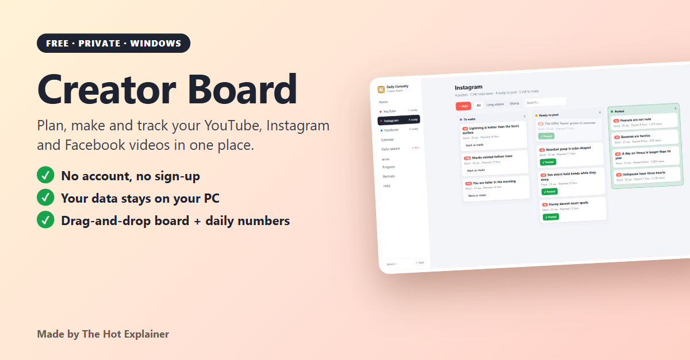
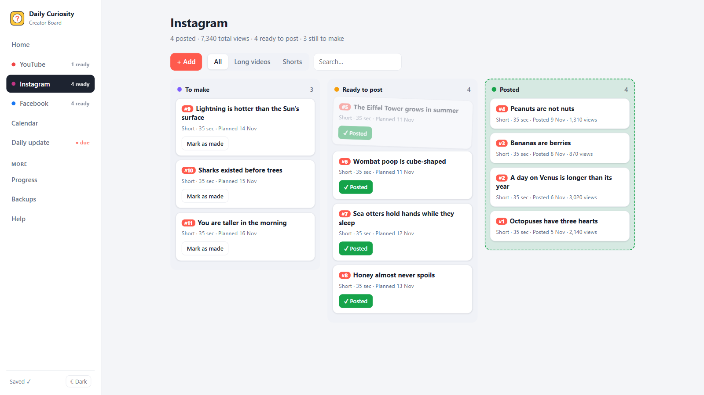
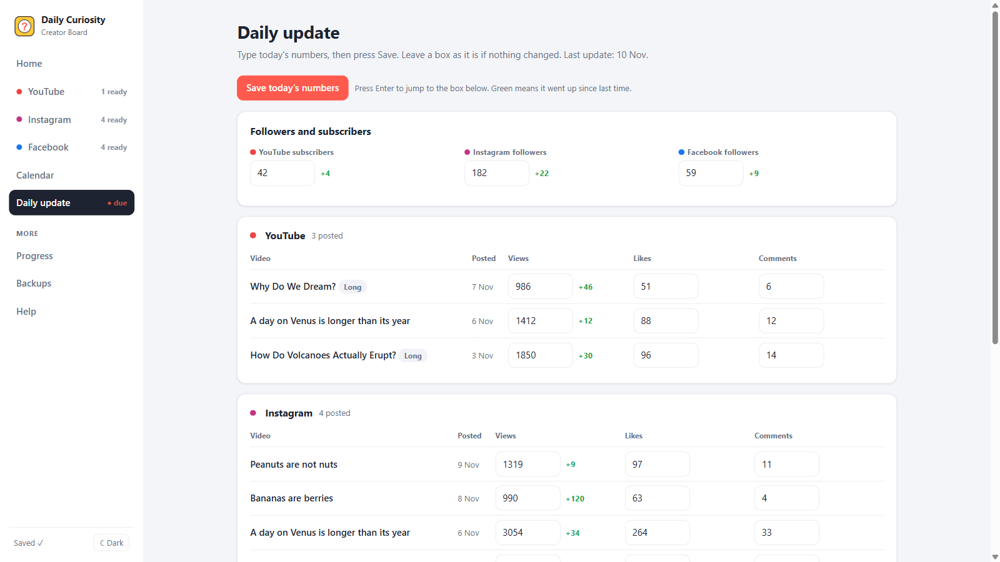
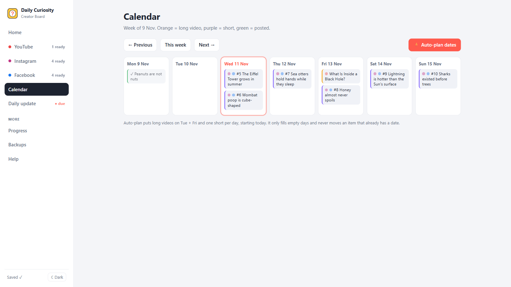
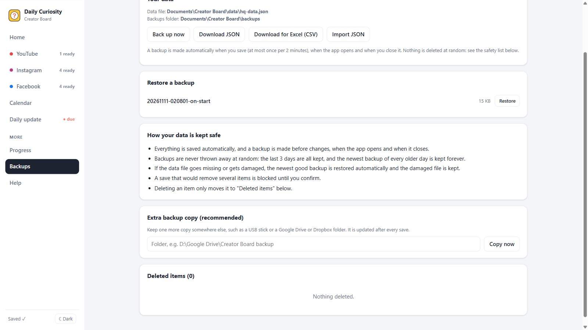

# Creator Board

**A free, private planner for YouTube, Instagram and Facebook creators.**
Plan ideas, drag them from *To make* to *Posted*, plan your week, and type your numbers once a day. Everything stays on your own computer: **no account, no sign-up, no ads, no tracking, no internet needed.**



## Download
Go to **[Releases](../../releases/latest)** and download **`Creator-Board-Setup.exe`** (Windows). Double-click it, click Next, Install. No administrator password is needed.

> Windows may say **"Windows protected your PC"** because the app is new and not yet signed with a publisher certificate. Click **More info**, then **Run anyway**. See [Is it safe?](#is-it-safe) for how to check the file first.

## What it does
| | |
|---|---|
| **Board** | One board per platform: **To make → Ready to post → Posted**. Drag cards across (like Trello) or use the buttons. |
| **Home** | What to post today, what is coming this week, what to make next. |
| **Calendar** | A weekly view. **Auto-plan** puts your ideas on free days. |
| **Daily update** | Type followers, views, likes and comments once a day. Green numbers show growth. History is kept. |
| **Progress** | A growth chart and your own targets. |
| **Safe by design** | Auto-save, automatic backups, undo on every action, automatic recovery. |

| Board | Daily update |
|---|---|
|  |  |
|  |  |

*(The screenshots use made-up demo data.)*

## Is it safe?
Nobody should install an unknown `.exe` on trust, so here is how to check this one.
- **It is open source.** Every line is in this repository. The whole app is a few small files (`server.js`, `electron-main.js`, `public/`).
- **It makes no internet connections.** It runs a tiny server on `127.0.0.1` (your own computer only) and shows it in a window. It has no analytics, no updater and no accounts. See [PRIVACY.md](PRIVACY.md) for how to check this yourself.
- **The installer is built from this code by GitHub**, not on a private computer. Each release shows the build log, a **SHA-256 checksum** and a **build provenance attestation** you can verify.
- **Check the checksum** of your download: in PowerShell run `Get-FileHash .\Creator-Board-Setup.exe -Algorithm SHA256` and compare it with `SHA256SUMS.txt` on the release page.
- **Verify where it was built** (needs the free [GitHub CLI](https://cli.github.com)): `gh attestation verify Creator-Board-Setup.exe --repo atularc/creator-board`.
- **Scan it** with Windows Defender or [VirusTotal](https://www.virustotal.com) if you like. Brand-new apps sometimes get a false alarm from one or two scanners.
- **Code signing:** the installer is not signed yet; see [docs/SIGNING.md](docs/SIGNING.md). Until then Windows shows the "protected your PC" screen.
- Or **build it yourself** (below).

## Where is my data?
In one plain file on your computer. At the first start the app asks where to keep it. The suggested place is `Documents\Creator Board\data\hq-data.json`, with backups in `Documents\Creator Board\backups\`.
In the app: **File > Open my data folder** or **File > Change data folder…**. Uninstalling never deletes your data.

## How your data is kept safe
- Every save is written to a temporary file first and then swapped in, so a crash cannot leave half a file.
- A backup is made before changes, when the app opens and when it closes. Backups are **never deleted at random**: the last 3 days are all kept, and the newest backup of every older day is kept forever.
- A **missing or damaged data file is restored automatically** (from the last good copy or the newest backup), and the damaged file is kept.
- A save that would **remove several items is blocked** until you confirm. Deleting only moves an item to *Deleted items*.
- Optional **extra backup copy** to a folder you choose (USB stick, Google Drive, Dropbox), updated after every save.
- These behaviours are covered by [automated tests](tests/safety-test.mjs) (`npm test`) that simulate damaged, empty and deleted files, accidental mass deletes and more.

## Let your AI assistant update it (optional)
Your data is a plain JSON file, so an assistant such as Claude can edit it. Give it [FOR-CLAUDE.md](FOR-CLAUDE.md) (a copy is saved next to your data file) and say: *"Read FOR-CLAUDE.md and keep my Creator Board updated. Tell me in one line what you changed."*

## Build it yourself
Requirements: [Node.js](https://nodejs.org) 22 or newer.
```
npm install
npm test          # runs the safety tests
npm start         # opens the app
npm run dist      # builds the Windows installer into dist/
```
You can also run it without Electron: `node server.js`, then open `http://localhost:4177`.

## Need something built for your business?
I build custom apps and tools: planners, trackers, internal dashboards and more. Message me on LinkedIn.

## Licence
[MIT](LICENSE). Free to use, copy and change. Made by **The Hot Explainer**.
